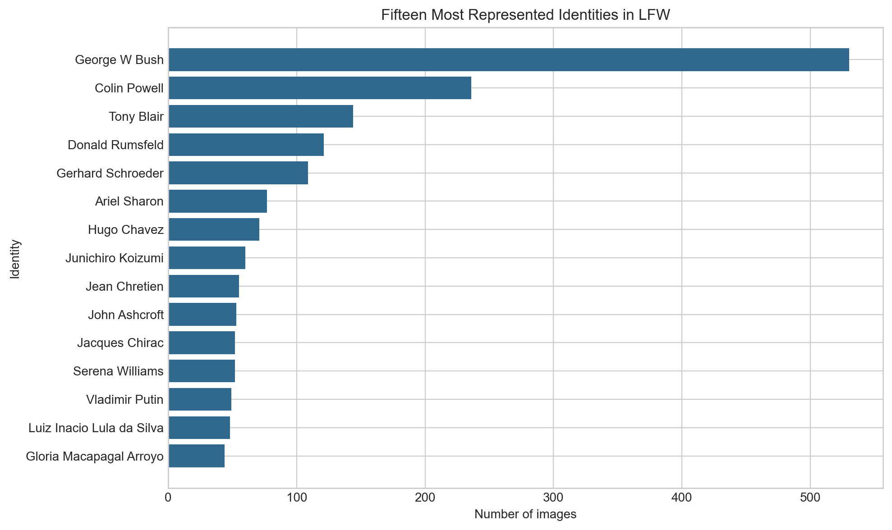
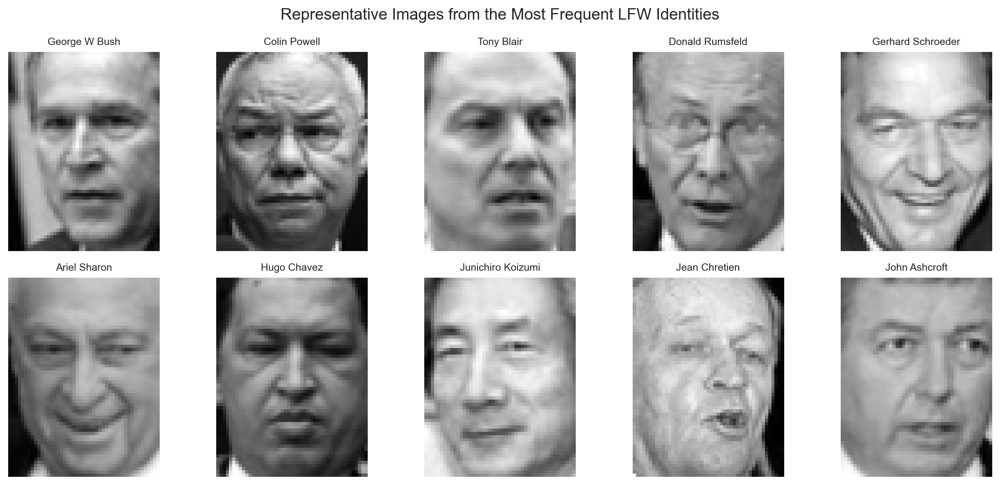
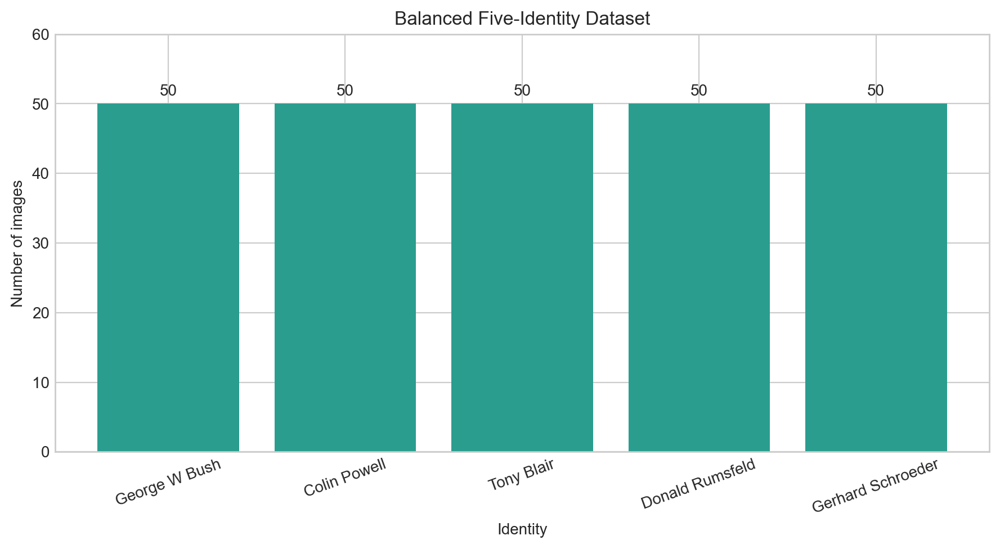
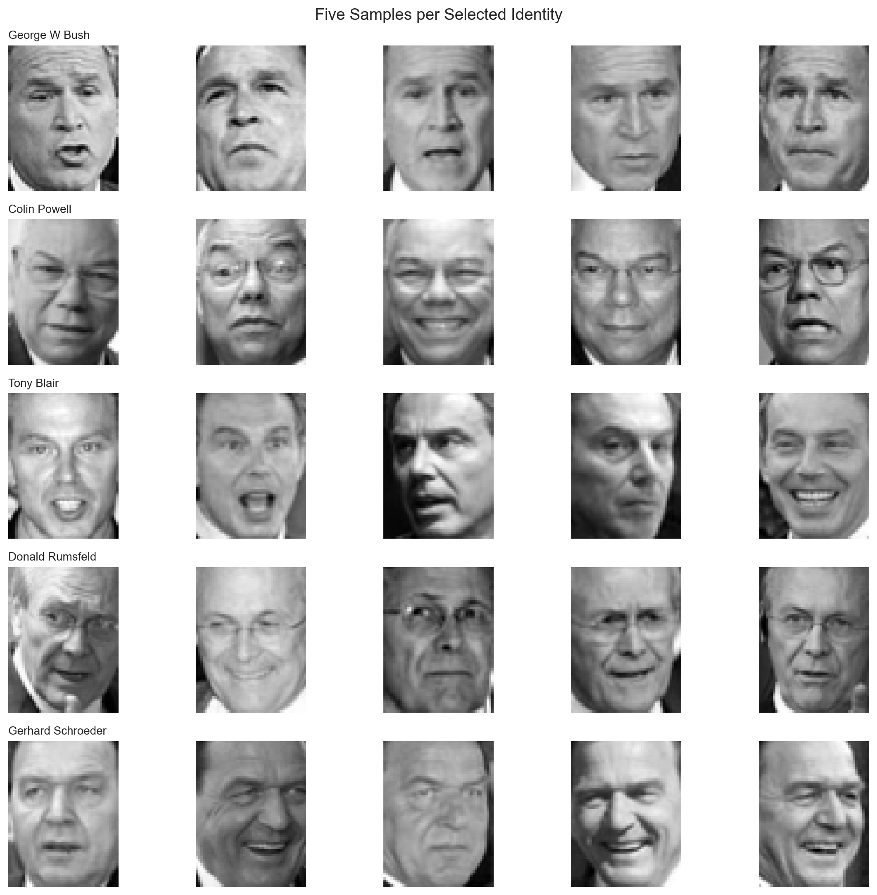
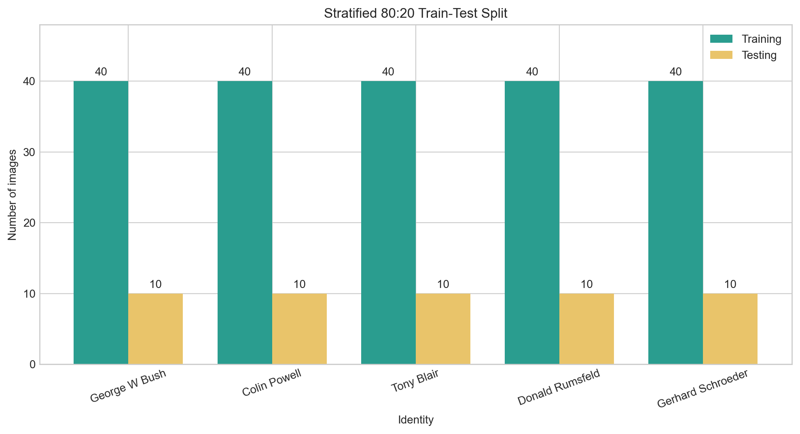
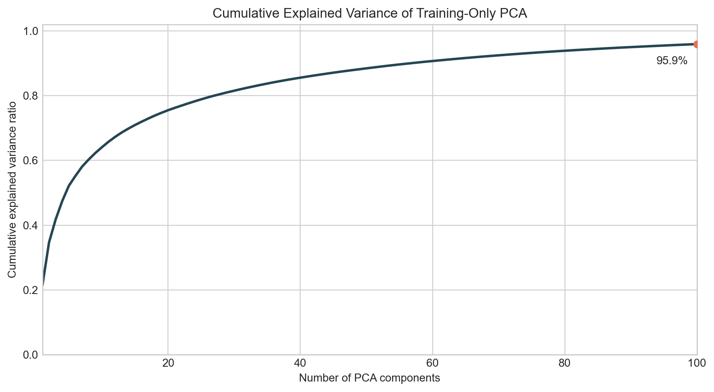
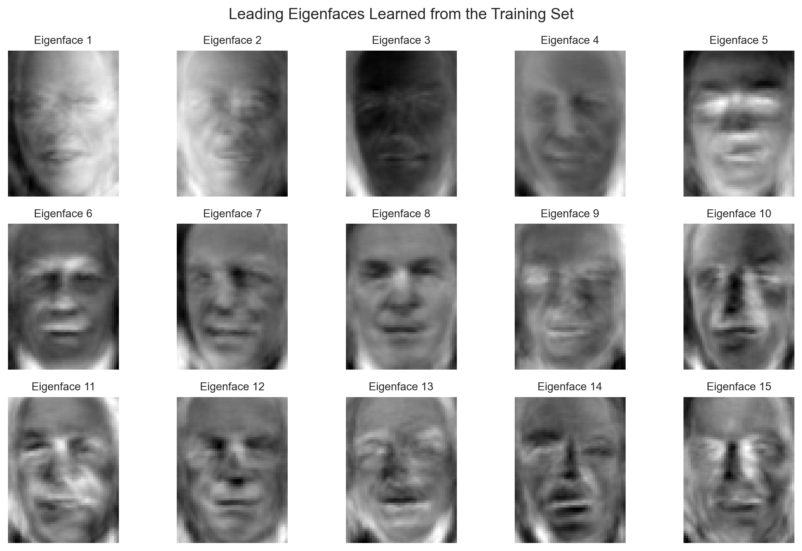

# Face Identification Using PCA and k-Nearest Neighbours

A closed-set face-identification system that recognises one person from a gallery of five known identities. The project represents facial images with PCA-based Eigenfaces and classifies them using k-Nearest Neighbours (k-NN).

## Overview

Face identification is a one-to-many matching problem: a query face is compared with several known identities, and the system returns the closest match. This project builds a compact and interpretable identification pipeline using classical machine-learning techniques rather than a deep neural network.

The system uses the Labeled Faces in the Wild (LFW) dataset and evaluates performance on a balanced five-person subset.

## Project Goals

- Build a reproducible face-identification pipeline.
- Select five identities using a documented and repeatable rule.
- Maintain an equal number of images for every identity.
- Extract compact facial features using PCA/Eigenfaces.
- Select the number of PCA components and the value of `k` through cross-validation.
- Evaluate the final model on an untouched test set.
- Analyse correct predictions, misclassifications, and commonly confused identities.

## Methodology

```text
LFW face images
       |
       v
Balanced five-identity subset
       |
       v
Stratified train-test split
       |
       v
PCA / Eigenface feature extraction
       |
       v
k-NN classification
       |
       v
Evaluation and error analysis
```

The planned workflow is:

1. Load LFW through Scikit-learn.
2. Select five identities with sufficient images.
3. Sample the same number of images for each identity.
4. Create a stratified training and testing split.
5. Fit PCA using training data only to prevent data leakage.
6. Transform each image into an Eigenface feature vector.
7. Select model parameters using cross-validation on the training set.
8. Evaluate the selected model once on the held-out test set.

## Repository Structure

```text
.
|-- README.md
|-- requirements.txt
|-- .gitignore
|-- face_identification.ipynb
|-- report/
|   `-- README.md
|-- results/
|   |-- README.md
|   |-- lfw_identity_distribution.png
|   |-- lfw_sample_faces.png
|   |-- balanced_identity_distribution.png
|   |-- balanced_sample_faces.png
|   |-- train_test_distribution.png
|   |-- pca_explained_variance.png
|   `-- eigenfaces.png
`-- src/
    `-- README.md
```

The notebook will contain the complete exploratory and experimental workflow. Reusable functions may also be placed in `src/` as the implementation develops.

## Installation

Python 3.10 or later is recommended.

```powershell
git clone https://github.com/Krrishchanchal/face-identification-knn.git
cd face-identification-knn

python -m venv .venv
.venv\Scripts\Activate.ps1
python -m pip install --upgrade pip
pip install -r requirements.txt
```

Start Jupyter Notebook with:

```powershell
jupyter notebook
```

Then open `face_identification.ipynb` and run the cells in order.

The LFW dataset will be downloaded automatically by Scikit-learn during the first run. Downloaded data is excluded from Git.

## Experimental Design

The initial experiment uses:

- 5 known identities
- A balanced number of images per identity
- An 80:20 stratified train-test split
- PCA/Eigenfaces for dimensionality reduction
- k-NN for classification
- Cross-validation for parameter selection

The test set remains untouched until model selection is complete. This provides a more reliable estimate of performance on unseen images of the five known people.

## Dataset Exploration

The complete LFW dataset used by the notebook contains:

- 13,233 face images
- 5,749 identities
- 62 x 47 grayscale pixels per image
- 2,914 flattened pixel features per image
- 12 identities with at least 50 images
- 4,069 identities represented by only one image

The strong class imbalance motivates selecting sufficiently represented identities and sampling an equal number of images from each person.





### Balanced Working Dataset

The five identities with the largest number of available images are selected by a documented rule rather than by manual preference. The notebook then samples 50 unique images from each identity without replacement, using random seed `42` for reproducibility.

| Identity | Images available | Images selected |
|---|---:|---:|
| George W. Bush | 530 | 50 |
| Colin Powell | 236 | 50 |
| Tony Blair | 144 | 50 |
| Donald Rumsfeld | 121 | 50 |
| Gerhard Schroeder | 109 | 50 |

This produces a balanced working dataset of 250 images. Balancing prevents identities with more photographs in LFW from having greater influence solely because of their class size.





### Stratified Train-Test Split

The balanced subset is divided using an 80:20 stratified split with random seed `42`. The training set contains 200 images (40 per identity), while the held-out test set contains 50 images (10 per identity). Integrity checks confirm that the two sets contain no overlapping source images and together cover all 250 selected images.



The test set will remain untouched while PCA and k-NN parameters are selected. PCA must be fitted only on the training data so information from the test images cannot influence the learned Eigenface representation.

### PCA and Eigenfaces

An exploratory PCA transformer is fitted exclusively on the 200 training images. It reduces each face from 2,914 pixel values to 100 whitened PCA coefficients and retains 95.92% of the variance present in the training data. The 50 test images are projected using the training mean and components without influencing the fitted representation.



The leading Eigenfaces visualise the strongest directions of variation learned from the training faces. They capture recurring contrasts associated with facial structure, pose, illumination, and background rather than representing individual people.



The 100-component setting is exploratory. The final PCA component count will be selected together with the k-NN parameters using cross-validation confined to the training set.

## Evaluation

The system will be evaluated using:

- Classification accuracy
- Precision, recall, and F1-score for each identity
- Confusion matrix
- Cross-validation performance
- Correct and incorrect prediction examples
- Visual analysis of frequently confused identities

Model metrics and evaluation figures will be added after the complete experiment has been run.

## Limitations

This is a closed-set identification system: every test image is assumed to belong to one of the five known identities. Standard k-NN will always return one of those identities, even when the query contains an unknown person. Supporting unknown identities would require an open-set evaluation protocol and a validated rejection threshold.

Performance may also be affected by changes in pose, facial expression, illumination, occlusion, and image quality.

## Future Improvements

- Add unknown-person rejection.
- Compare uniform and distance-weighted k-NN.
- Evaluate more identities and more challenging test images.
- Add automatic face detection and alignment.
- Compare Eigenfaces with HOG features and deep face embeddings.
- Evaluate robustness on CCTV-like images.

## References

Dataset and methodology references will be added as the implementation is completed.
